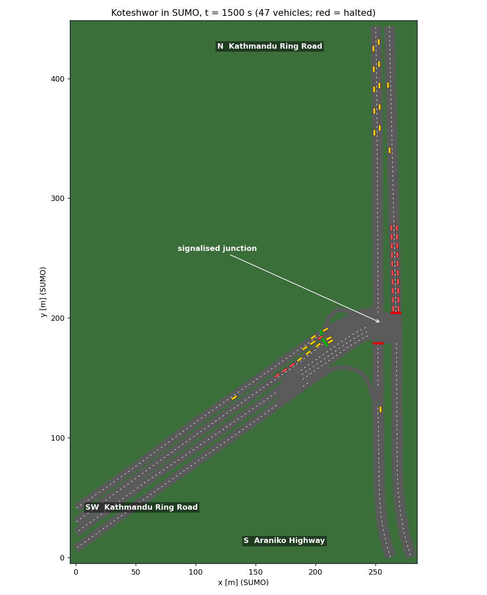

# Deep Q-Learning Agent for Traffic Signal Control

A PyTorch-based Deep Q-Learning agent that learns to operate a single signalized junction in **SUMO**. The repo bundles a configurable training pipeline, a small CLI, and plotting utilities so you can focus on experimenting.

- **Agent**: epsilon-greedy DQN with experience replay and a configurable fully connected network.
- **Environment**: any single signalized junction, read from the SUMO network (any number of arms, lanes and phases; left- or right-hand traffic). The state is the occupancy of cells along each incoming lane; the actions are the green phases of the signal program. Bundled: the original 4-arm intersection and a left-hand 3-arm T-junction.
- **Outputs**: trained model, copied settings, and plots for rewards, delay, and queue lengths.

## Prerequisites

- [uv](https://astral.sh/uv) installed.
- Python 3.13 (see `pyproject.toml`; you can manage Python versions directly via [uv](https://astral.sh/uv), which can download it for you).
- SUMO installed and available via `sumo` / `sumo-gui` on your PATH. To do so, the environment variable `SUMO_HOME` must be set. For specific instructions, check out the [official installation page](https://sumo.dlr.de/docs/Installing/).
- GPU is optional; the default configuration trains on CPU.

> **Note:** as of November 2025, macOS Tahoe and SUMO-GUI have an issue that can crash the SUMO GUI. In particular, the bug lies with the XQuartz library. See:
>
> - https://github.com/eclipse-sumo/sumo/issues/17272
> - https://github.com/XQuartz/XQuartz/issues/446
> - https://github.com/XQuartz/XQuartz/issues/438#issuecomment-3350746279

## Getting started

Clone the repo. Then from the project root, install the dependencies:

```bash
uv sync
```

Activate the virtual environment:

```bash
source .venv/bin/activate   # on Windows: .venv\Scripts\activate
```

To check if the installation was successful, verify that the CLI is available:

```bash
tlcs --help
```

When you are finished, deactivate the virtual environment:

```bash
deactivate
```

Alternatively, if you prefer not to activate the environment explicitly, you can run commands via uv:

```bash
uv run tlcs --help
```

## Train and test

Training and testing read YAML configuration from `settings/`. Both commands prompt before overwriting existing output folders.

- **Train** (defaults to `settings/training_settings.yaml`, writes to `model/`):

  ```bash
  tlcs train
  # or choose a custom run folder
  tlcs train --out-path model/run-01
  ```

- **Test** a trained run (defaults to `settings/testing_settings.yaml`, writes to `model/<run>/test/`):

  ```bash
  tlcs test --model-path model/run-01 --test-name foo
  ```

Discover all options with:

```bash
tlcs train --help
tlcs test --help
```

## Command cheat sheet

Run all commands from the project root, because the SUMO config and the generated routes file are resolved relative to the current directory. If the virtual environment is not activated, prefix each `tlcs` command with `uv run`.

### Setup and sanity checks

```bash
uv sync                      # install dependencies
tlcs --help                  # check the CLI is installed
echo $SUMO_HOME              # PowerShell: echo $env:SUMO_HOME
sumo --version               # check SUMO is on your PATH
```

### Training

```bash
tlcs train --out-path model/run-01                                    # default settings
tlcs train --settings-file settings/my_train.yaml --out-path model/run-02  # custom settings
tlcs train --out-path model/run-01 > train.log 2>&1                   # also save the log (PowerShell: *> train.log)
```

To watch training in the SUMO GUI, set `gui: true` in the training settings (this is much slower). For a quick smoke test, lower `total_episodes` (for example to 5).

Every `checkpoint_every` episodes (default 100), training saves the model so far to `<out-path>/checkpoints/episode_0100/`, `episode_0200/`, and so on. Each checkpoint folder has its own `trained_model.pt` and `training_settings.yaml`, so it can be tested like any model:

```bash
tlcs test --settings-file settings/koteshwor_testing_medium.yaml --model-path model/koteshwor-dqn-1000/checkpoints/episode_0500 --test-name test-medium

# Test every checkpoint and plot test results against training episodes (picks the best by waiting time)
uv run python scripts/eval_checkpoints.py --run model/koteshwor-dqn-1000 --settings-file settings/koteshwor_testing_medium.yaml --test-name test-medium --reference "fixed=baselines/koteshwor/fixed"

# Learning curves of several runs side by side
uv run python scripts/plot_learning_curves.py --runs model/koteshwor model/koteshwor-dqn-1000 --labels "100 episodes" "1000 episodes" --out docs/figures/learning_curves.png --clip
```

`eval_checkpoints.py` writes `<run>/checkpoints/<test-name>_eval.csv` and `_eval.png`. It reuses checkpoint tests that already exist unless you pass `--rerun`. With `--clip`, `plot_learning_curves.py` limits each row's y-axis to the 1st–99th percentile, so a few extreme episodes (such as a jammed one) don't flatten the curves. Off-scale episodes are marked and listed on the plot.

### Testing a trained model

```bash
tlcs test --model-path model/run-01 --test-name test1
tlcs test --settings-file settings/my_test.yaml --model-path model/run-01 --test-name test2
```

`testing_settings.yaml` has `gui: true` by default, so the SUMO GUI opens. Press **Play** (▶) to start the simulation and increase the *Delay* slider to slow it down. Results are written to `model/run-01/<test-name>/`. The test episode uses `episode_seed`, so runs are repeatable.

### Other networks (left-hand T-junction)

Every command takes the network from its settings file. The T-junction has its own pair:

```bash
tlcs train    --settings-file settings/t_junction_training.yaml --out-path model/t_junction
tlcs test     --settings-file settings/t_junction_testing.yaml  --model-path model/t_junction
tlcs baseline --settings-file settings/t_junction_testing.yaml  --controller lqf --test-name tj-lqf
tlcs live     --settings-file settings/t_junction_testing.yaml  --model-path model/t_junction
```

Koteshwor works the same way with `settings/koteshwor_training.yaml` and `settings/koteshwor_testing.yaml` (see [Koteshwor](#koteshwor-openstreetmap-import)).

A model only works on the network it was trained on. `tlcs test` stops with an error if the testing settings use another network or signal program. See [Networks](#networks).

### Baselines and comparison

```bash
# Run each baseline on the same seeded scenario as `tlcs test` (results in baselines/<test-name>/)
tlcs baseline --controller fixed       --test-name fixed
tlcs baseline --controller random      --test-name random
tlcs baseline --controller lqf         --test-name lqf
tlcs baseline --controller maxpressure --test-name maxpressure
tlcs baseline --controller actuated    --test-name actuated

# Compare any test runs (DQN and baselines): plots + summary.csv in comparison/
tlcs compare --runs model/run-01/test baselines/fixed baselines/random baselines/lqf baselines/maxpressure baselines/actuated
tlcs compare --runs model/run-01/test baselines/lqf --out-path comparison/dqn-vs-lqf --smooth 1

# Runs at several demand levels: one grouped bar chart per metric; --labels names each run
tlcs compare --runs model/koteshwor/test-low baselines/koteshwor-low/fixed model/koteshwor/test baselines/koteshwor/fixed --labels dqn,fixed,dqn,fixed --out-path comparison/by-demand
```

For a fair comparison, run `tlcs test` and `tlcs baseline` with the **same** testing settings file. See [Baselines](#baselines) for what each controller does.

`--labels` takes one comma-separated label per run, in `--runs` order (default: folder names). The demand of each run (`n_cars_generated`) is read from its `run_info.json`. If the runs have more than one demand, `tlcs compare` switches to grouped mode: one group of bars per demand, one bar per label. Give one controller the same label at every demand. Up to 8 runs, or 8 labels in grouped mode, fit in one comparison.

`tlcs compare` only reads runs that finished. If a SUMO-GUI window is closed or the run is interrupted before the last step, no plots or data are written for it.

### Watch all methods side by side

```bash
tlcs live --model-path model/run-01                              # DQN + all 5 baselines
tlcs live --model-path model/run-01 --controllers dqn,lqf,actuated
tlcs live --model-path model/run-01 --delay 20 --view-radius 200  # slower, wider view
```

This opens **one SUMO-GUI window per method**, tiled on screen. The window title shows the method, for example `live_dqn.sumocfg`. Every window is zoomed on its junction and runs the same seeded traffic, and all windows advance together one simulation second at a time. You can watch queues build up differently under each controller at the same moment. The windows close at the end.

Each method runs in its own SUMO process, so the results are identical to separate `tlcs test` / `tlcs baseline` runs. They are saved to `live/<method>/`, and a comparison of all methods goes to `live/comparison/`. The GUI follows `gui` in the testing settings: with `gui: false` the same run is done headless, which is a quick way to produce every result and the comparison in one command.

Options: `--controllers` (comma-separated, default all six), `--delay` (ms per step per window, default 0), `--view-radius` (meters shown around each junction, default 120), `--out-path` (default `live/`). Six windows rendering every step take several minutes for a full 5400-step episode. Lower `max_steps` in a copy of the settings for a shorter demo.

### Unit tests

```bash
uv run pytest
```

The tests cover the OSM import helpers (bounding box order, bounds check, clipping, turn restrictions, arms, phase plan) and the committed Koteshwor network, network discovery, state cells, route generation, settings validation, baseline decision logic, episode wiring, checkpoint saving, the Koteshwor demand presets and the comparison tool (including throughput and grouping by demand). They do not need SUMO.

### Inspect the intersection without the agent

```bash
sumo-gui -c intersection/original/sumo_config.sumocfg
sumo-gui -c intersection/t_junction/sumo_config.sumocfg
```

This needs the folder's `episode_routes.rou.xml`, which is generated by any `tlcs train`, `test` or `baseline` run on that network.

## The settings

Configs live in `settings/` and are validated at runtime.

`training_settings.yaml`

- `gui`: run SUMO with (`true`) or without (`false`) the GUI.
- `total_episodes`, `max_steps`, `n_cars_generated`: episode count, length, and traffic volume.
- `green_duration`, `yellow_duration`: phase durations in seconds.
- `turn_chance`: probability that a vehicle turns instead of going straight.
- `num_layers`, `width_layers`: hidden layer count and width for the neural network.
- `batch_size`, `learning_rate`, `training_epochs`: replay batch size, optimizer LR, and training passes per episode.
- `memory_size_min`, `memory_size_max`: replay buffer warmup and capacity.
- `gamma`: discount factor.
- `network`: folder under `intersection/` with the SUMO network (default `original`). See [Networks](#networks).
- `tls_id`: traffic light to control; `null` (default) uses the only traffic light in the network.
- `signal_program`: tlLogic file in the network folder whose green phases are the actions (for example `phases_per_approach.add.xml` for Koteshwor); `null` (default) uses the program in the net file.
- `cells_per_lane`: state cells per incoming lane (default `5`). State size = incoming lanes × `cells_per_lane`. Testing reuses the value saved with the model.
- `checkpoint_every`: save a checkpoint of the model every N episodes into `checkpoints/` of the run (default `100`; `0` turns checkpoints off).

`testing_settings.yaml`

- Mirrors the simulation settings (`gui`, `max_steps`, `n_cars_generated`, `green_duration`, `yellow_duration`, `turn_chance`, `gamma`, `network`, `tls_id`, `signal_program`) plus:
- `episode_seed`: deterministic route generation for a reproducible test episode.
- Optional, used only by `tlcs baseline` (defaults apply when omitted):
  - `fixed_green_durations`: green time in seconds per green phase, in signal-program order, for the fixed-time controller (4 values for `original`, 2 for `t_junction`). Default: `green_duration` for every phase.
  - `actuated_max_green`: maximum green in seconds for SUMO's actuated controller (default `60`). The minimum green is `green_duration`.

Settings files from before the `network` option may still contain `sumocfg_file`; it is ignored.

## What gets saved

Each training run writes to the chosen output training folder:

- `trained_model.pt`: serialized PyTorch model.
- `training_settings.yaml`: copy of the settings used.
- `checkpoints/episode_NNNN/`: the model after NNNN episodes (`trained_model.pt` + `training_settings.yaml`), every `checkpoint_every` episodes.
- `plot_reward.png`, `plot_delay.png`, `plot_queue.png` and matching `*_data.txt` files.
- Testing outputs are saved within the training folder in a dedicated testing subfolder with reward and queue plots plus data.

Each test run (`tlcs test` or `tlcs baseline`) writes:

- `testing_settings.yaml`, `plot_reward.png`, `plot_queue.png` and matching `*_data.txt` files.
- `reward_steps_data.txt`: simulation step at which each reward was measured.
- `tripinfo.xml`: SUMO per-vehicle trip info, including vehicles still on the road at the end.
- `run_info.json`: controller name and scenario parameters.

`tlcs compare` writes to its `--out-path` (default `comparison/`):

- `compare_wait.png`: average waiting time per vehicle (mean of `waitingTime` in `tripinfo.xml`).
- `compare_queue_mean.png`: mean queue length over the episode.
- `compare_throughput.png`: throughput, the number of vehicles that finished their trip (arrival time set in `tripinfo.xml`) before the episode ended.
- `compare_queue.png`: queue length over time (moving average, set with `--smooth`). Only when all runs have the same demand.
- `compare_reward.png`: cumulative negative reward over time. Only when all runs have the same demand.
- `summary.csv`: one row per run with its demand, average waiting time, average entry delay, mean and max queue, throughput, cumulative negative reward and vehicle count. The entry delay (SUMO `departDelay`) is how long cars waited to *enter* the map because their entry lane was full, meaning the queue reached the map edge. It is not part of the waiting time, so read the two together under heavy traffic. The same table is printed to the terminal.

With runs at several demands, the three bar charts are grouped by demand (see [Baselines and comparison](#baselines-and-comparison)).

Runs saved before these extra files existed can still be compared. Waiting time is then shown as `n/a`, and rewards are plotted against action index.

## Project layout

- `src/tlcs/cli.py`: CLI exposing `tlcs train`, `tlcs test`, `tlcs baseline`, `tlcs compare` and `tlcs live`.
- `src/tlcs/live.py`: side-by-side viewer that steps one SUMO simulation per method in lockstep.
- `src/tlcs/baselines.py`: non-learning baseline controllers and the `baseline` session.
- `src/tlcs/compare.py`: loads saved test runs and produces comparison plots and the summary table.
- `tests/`: pytest suite (no SUMO needed).
- `src/tlcs/main.py`: orchestrates training/testing loops and stats aggregation.
- `src/tlcs/agent.py`, `model.py`, `memory.py`: epsilon-greedy policy, MLP, and replay buffer.
- `scripts/import_osm.py`: imports a junction from OpenStreetMap and verifies it (see [Koteshwor](#koteshwor-openstreetmap-import)); `src/tlcs/osm_import.py` holds its reusable, tested parts.
- `scripts/eval_checkpoints.py`: tests every checkpoint of a training run and plots the results against training episodes. `scripts/plot_learning_curves.py`: learning curves of several runs side by side.
- `docs/koteshwor_results.md`: Koteshwor results, 100 vs 1000 training episodes vs baselines at three demand levels.
- `docs/final/`: presentation package (figures, tables, training-length comparison, demo instructions) and `limitations.md`.
- `scripts/demo_koteshwor.py`: SUMO-GUI demo for recording: Koteshwor at high demand, best DQN, then fixed-time. `scripts/plot_network_bbox.py`: picture of an imported network with its bounding-box coordinates.
- `src/tlcs/network.py`: reads the junction (traffic light, lanes, movements, green/yellow states, routes) from the network file.
- `src/tlcs/env.py`: SUMO wrapper (state extraction, reward, action execution).
- `src/tlcs/generator.py`: per-episode route generation.
- `src/tlcs/plots.py`: saves plots plus raw data.
- `intersection/<network>/`: one folder per network (`original`, `t_junction`, `koteshwor`), each with its `*.net.xml` and `sumo_config.sumocfg`. `koteshwor/` also has `bbox.yaml`, the downloaded `map.osm`, `phases_per_approach.add.xml` and `network.png`.
- `media/`: README figures (`env.png` for the original intersection, `koteshwor_sumo.png` for Koteshwor in SUMO).
- `settings/`: YAML configs for training and testing (`training_settings.yaml` / `testing_settings.yaml` for `original`, `t_junction_*.yaml` for the T-junction, `koteshwor_*.yaml` for Koteshwor).

## Networks

Each network lives in its own folder under `intersection/` and is chosen with the `network` setting:

| Folder | Junction | Actions | State size (5 cells/lane) |
| --- | --- | --- | --- |
| `original` (default) | 4 arms, right-hand traffic, 750 m arms | 4 | 16 lanes × 5 = 80 |
| `t_junction` | 3 arms (T), **left-hand** traffic, 300 m arms | 2 | 6 lanes × 5 = 30 |
| `koteshwor` | Real 3-arm junction in Kathmandu from OpenStreetMap, **left-hand** traffic | 3 (one per approach) | 8 lanes × 5 = 40 |

A network folder holds exactly one `*.net.xml` and a `sumo_config.sumocfg` that loads it plus `episode_routes.rou.xml`. The routes file, `tls_actuated.add.xml` and `live_*.sumocfg` are generated into the same folder and git-ignored.

**Nothing about the junction is hard-coded.** At startup, `src/tlcs/network.py` reads the net file with `sumolib` and discovers:

- the traffic light (`tls_id`, or the only one in the network),
- its incoming and outgoing lanes, and the controlled movements (incoming lane → outgoing lane),
- the green phases of its signal program (each becomes one action) and the yellow after each green. If the program has no yellow after a green, one is generated,
- the movements through the junction at road level (with SUMO's turn direction), used to generate traffic.

Driving side, number of arms, lanes and phases all come from the network, so left-hand junctions work like any other.

**Adding a network:** create `intersection/<name>/` with one `*.net.xml` (one signalized junction) and a `sumo_config.sumocfg` like the existing ones. Then set `network: <name>` in both settings files. The T-junction was built from its node and edge files with:

```bash
cd intersection/t_junction
netconvert --lefthand --no-turnarounds --node-files t_junction.nod.xml --edge-files t_junction.edg.xml -o t_junction.net.xml
```

> **Models trained before this change** (such as `model/run-01`) used a different state layout (8 lane groups × 10 cells). They still load (same size, 80), but their inputs now mean something else, so retrain them.

## Koteshwor (OpenStreetMap import)

`intersection/koteshwor/` is the real **Koteshwor junction, Kathmandu, Nepal** (27.6786 N, 85.3494 E), imported from OpenStreetMap. It is a 3-arm junction with left-hand traffic: **N** Kathmandu Ring Road, **S** Araniko Highway and **SW** Kathmandu Ring Road. A free left-turn slip lane takes Araniko traffic to the SW Ring Road, bypassing the signal. Traffic is synthetic and cars only.

### Methodology on Koteshwor

<p align="center">
  
</p>
<p align="center">
  <em>The Koteshwor junction as built in SUMO from the OpenStreetMap export, at t = 1500 s of the test episode (seed 10000) under the per-approach signal plan. Bars at the stop lines show the signal of each link; red cars are halted. The SW-arm green is on, and the N queue waits at red.</em>
</p>

The learning method is the same as on the 4-way intersection (see [Methodology](#methodology)). Only the network differs, and everything about it is read from `environment.net.xml` and `phases_per_approach.add.xml`. Settings: `settings/koteshwor_training.yaml` and `settings/koteshwor_testing.yaml`.

#### Koteshwor: scenario and state

- The map covers the box 27.677–27.681 N, 85.347–85.351 E (about 280 m × 440 m in SUMO). It is built from OSM as described in [Import](#import): left-hand traffic, arterial roads only, the 7 OSM junction nodes joined into one signalised junction.
- 8 incoming lanes are controlled by the light: 2 on N (Ring Road, 239 m), 2 + 2 on the two SW Ring Road roadways (251 m and 256 m), 2 on S (Araniko Highway, 35 m before the slip lane splits off).
- Each lane is split into 5 cells from the stop line. On the long arms the cells grow geometrically (N: 7.5 / 23 / 53 / 115 / 239 m). The 35 m Araniko lanes are too short for that and get 5 equal cells of about 7 m.
- State vector: 8 lanes × 5 cells = **40** binary values (`1` if a vehicle is in the cell).

#### Koteshwor: actions and signals

There are **3 actions**, one green per approach, from `phases_per_approach.add.xml`:

| Action | Green for | Movements |
| --- | --- | --- |
| 0 | N (Ring Road) | N → S straight, N → SW right |
| 1 | S (Araniko Highway) | S → N straight |
| 2 | SW (both Ring Road roadways) | SW → N left, SW → S right |

- Each approach gets a protected green, so no two approaches move at the same time.
- On a change of action, the yellow of the current approach (`yellow_duration`, 4 s) is shown first, then the new green for `green_duration` (10 s).
- The free left turn from Araniko Highway to the SW Ring Road is a slip lane outside the junction and is never signalised.

#### Koteshwor: reward

Same as the 4-way intersection: the change in cumulative waiting time on the 4 incoming edges (N, both SW roadways, S).

```
reward = previous_total_wait - current_total_wait
```

On the S arm only the 35 m before the junction counts. See [Known limitations](#known-limitations).

#### Koteshwor: traffic generation

- 1000 cars per episode of 5400 steps (90 minutes), with Weibull departure times, as on the 4-way intersection.
- Routes are the junction's 7 movements. Each runs from the map edge through the junction to the map edge. Imported roads are split into several edges, so a route can have 2–3 edges.
- With `turn_chance: 0.25`, 75 % of cars take a straight movement (N → S or S → N) and 25 % take one of the 5 turns. The two SW → SW U-turns get no traffic, and no traffic is generated on the slip lane.
- Seeds: the episode index in training, `episode_seed: 10000` in testing.

#### Koteshwor: policy and learning loop

Unchanged from the 4-way intersection: epsilon-greedy DQN with experience replay, 100 training episodes, `gamma: 0.75`, 4 layers × 400 units, 800 replay batches of 100 per episode. The input size (40) and output size (3) come from the network at runtime. The baselines (`fixed`, `random`, `lqf`, `maxpressure`, `actuated`) run on Koteshwor with the same test seed, through the same code path.

### Import

```bash
uv run python scripts/import_osm.py                      # download, build and verify
uv run python scripts/import_osm.py --osm-file map.osm   # use a local OSM export of the same box
uv run python scripts/import_osm.py --verify-only        # re-check after manual edits (no rebuild)
uv run python scripts/import_osm.py --verify-only --write-program   # also rewrite the signal plan
```

The bounding box is stored once, in `intersection/koteshwor/bbox.yaml`, with named fields `south`, `west`, `north`, `east`, plus the expected junction point. Every tool's argument order (for example `min_lon,min_lat,max_lon,max_lat` for the OSM API) is built from those fields.

What the import does:

1. Downloads OSM data for exactly the box (only the box is sent to `api.openstreetmap.org`), or takes a local export. It stores the data as `map.osm` and stops with an error if the file's `<bounds>` differ from the box by more than 0.0001°.
2. Clips every road at the box edges, so the network ends exactly at the box.
3. Runs `netconvert` with these settings:
   - left-hand traffic (`--lefthand`)
   - cars-only arterial roads (trunk, primary, secondary, tertiary and their links). Footways, cycleways, paths, steps, service roads and residential lanes are dropped.
   - isolated edges removed
   - no U-turn connections
   - OSM one-way information and turn arrows kept
   - junction nodes joined when they are linked by edges shorter than `--join-dist` (default 15 m). This turns the 7 OSM nodes of Koteshwor into one junction.
4. Re-applies OSM turn restrictions at the junction. Joining removes the "via" nodes netconvert used for them, so the import deletes the banned connections explicitly. Koteshwor has a `no_left_turn` from Araniko Highway into the Ring Road.
5. Puts a traffic light on the junction, keeping the OSM signal if there is one, and removes any other traffic light.
6. Writes `environment.net.xml`, `sumo_config.sumocfg` and `phases_per_approach.add.xml`.

Then it verifies and reports:

- the junction's latitude/longitude, converted back from SUMO x/y with `sumolib`. It warns if the junction is outside the box or more than 50 m from the expected point. Koteshwor: 27.67876 N, 85.34956 E, 24 m away.
- the network's boundary in lat/lon, side by side with the box. Koteshwor matches on the N, S and W sides; no arterial road reaches the E side.
- arms by compass direction and OSM road name, incoming lanes with lengths, every allowed turning movement, whether each OSM restriction is respected, and the signal phases.
- each arm's length from the junction to the box edge, along the road. It warns below 150 m. Koteshwor: N 239 m, S 162 m, SW 251–256 m.
- `network.png`: the network in lat/lon with the box edges and the junction labelled, to compare with openstreetmap.org.

> **Rebuilding overwrites manual edits** to `environment.net.xml`. After editing the network by hand, use `--verify-only`.

### Signal plan

`phases_per_approach.add.xml` gives **one green phase per approach** (N, S, SW). Every movement of that approach gets a protected green, so no two approaches move at the same time. It is selected with `signal_program: phases_per_approach.add.xml` in the Koteshwor settings. With `signal_program: null`, the actions come from netconvert's own program in the net file instead.

### Run

```bash
tlcs train    --settings-file settings/koteshwor_training.yaml --out-path model/koteshwor
tlcs test     --settings-file settings/koteshwor_testing.yaml  --model-path model/koteshwor
tlcs baseline --settings-file settings/koteshwor_testing.yaml  --controller actuated --test-name k-actuated --out-path baselines/koteshwor
tlcs live     --settings-file settings/koteshwor_testing.yaml  --model-path model/koteshwor
```

**Demand presets.** Three testing files differ from `koteshwor_testing.yaml` only in demand and in `gui: false`. All use the same seed (10000):

| Preset | File | Cars per 90-minute episode |
| --- | --- | --- |
| low | `settings/koteshwor_testing_low.yaml` | 600 |
| medium | `settings/koteshwor_testing_medium.yaml` | 1000 (same as training) |
| high | `settings/koteshwor_testing_high.yaml` | 1400 |

`settings/koteshwor_training_1000.yaml` is `koteshwor_training.yaml` with `total_episodes: 1000`. The 100- vs 1000-episode comparison against the baselines is in [docs/koteshwor_results.md](docs/koteshwor_results.md). The presentation version and its limitations are in [docs/final/](docs/final/README.md).

**Demo for a recording:** `uv run python scripts/demo_koteshwor.py` opens SUMO-GUI full screen at high demand and runs the best DQN, then fixed-time, on identical traffic. Options: `--minutes` (default 45), `--delay` (ms per step, default 20), `--no-pause`, and `--headless` (no GUI, to check that it runs). Results go to `live/demo-koteshwor-high/`.

**Network picture:** `uv run python scripts/plot_network_bbox.py --network koteshwor --out docs/final/figures/network_bbox.png` draws the imported roads with the bounding box and its corner coordinates.

### Check and fix the network in netedit

1. Open it: `netedit intersection/koteshwor/environment.net.xml`. Put `network.png` next to satellite imagery of 27.6788 N, 85.3496 E (for example openstreetmap.org with an imagery layer).
2. **Lanes:** click each approach and exit edge and compare its lane count with the imagery. The import has 2 incoming lanes on N and S, and 2 + 2 on the two SW roadways. The S (Araniko) incoming edge is only 35 m long, because the slip lane splits off just before the junction.
3. **Turning movements:** in *Connection* mode (`C`), click each incoming lane to see where it may go. Expected:
   - N → S straight, N → SW right
   - S → N straight only (S → SW goes by the slip lane)
   - SW → N left, SW → S right
4. **U-turns:** two SW → SW links (U-turns) were imported. Delete them if U-turns are not allowed there. No traffic is generated for U-turns either way.
5. **Slip lane:** check that the free left turn from Araniko Highway to the SW Ring Road exists and does not pass the signal.
6. **Save** (`Ctrl+S`) over `environment.net.xml`. Don't edit phases in netedit, because the plan lives in `phases_per_approach.add.xml`.
7. Re-run `uv run python scripts/import_osm.py --verify-only --write-program`. This repeats the coordinate checks and rewrites the plan, since changing connections changes the link order. Then run `uv run pytest`.

### Known limitations

- **Short Araniko approach.** The agent's state and the reward cover only the lanes that enter the junction. On the Araniko approach that is 35 m, before the slip lane split. Queues further back count only once they reach those 35 m.
- **Synthetic signal plan.** Koteshwor is police-controlled in reality. The traffic light and its phase plan are a modelling choice.
- **Synthetic demand.** Traffic is generated, not real counts. 1000 cars per 90 minutes already saturates the junction under fixed-time control.

## Methodology

<p align="center">
  
</p>
<p align="center">
  <em>The original intersection.</em>
</p>

### Scenario and state

- Every incoming lane controlled by the traffic light is split into `cells_per_lane` cells (default 5), measured from the stop line.
- Cells grow geometrically: the first is 7.5 m (about one car), the last ends at the far end of the lane. This keeps detail where queues form. On a 750 m lane the bounds are 7.5 / 29 / 89 / 261 / 750 m. Lanes too short for that get equal cells.
- State vector: incoming lanes × `cells_per_lane` values, `1` if at least one vehicle is in the cell, else `0` (original: 16 × 5 = 80; T-junction: 6 × 5 = 30).
- The network's input and output sizes are taken from the environment at runtime.

### Actions and signals

Each green phase of the junction's signal program is one action (original: NS straight/right, NS left, EW straight/right, EW left; T-junction: 2 phases from netconvert).

- When the chosen green differs from the current one, the yellow that follows the current green in the program is shown first. If a link would stay green in that yellow but is red in the next green, it turns yellow too, so no link ever jumps from green to red.
- The light is set by signal state (`setRedYellowGreenState`), so generated yellows need no extra program phases.
- `green_duration` and `yellow_duration` control how long each lasts.

### Reward

Reward is the **change in cumulative waiting time** on incoming edges:

```
reward = previous_total_wait - current_total_wait
```

Reducing total wait yields positive reward.

### Traffic generation

- One route file per episode generated on the fly.
- Departure times follow a Weibull distribution scaled to `[0, max_steps]`.
- Routes are the junction's own movements (entry road → exit road), read from the network. Each route follows the road from the network edge to the network edge (on imported maps an approach can consist of several edges). U-turns get no traffic. `turn_chance` controls whether a vehicle draws from turning or straight movements (SUMO direction `s`); within each group the movement is uniform. If a junction has no straight movement, every car turns.
- Cars only (one passenger-car type).
- Seeds (episode index for training; `episode_seed` for testing) make runs reproducible.

### Policy and learning loop

- Epsilon-greedy exploration: epsilon decays linearly from 1.0 to 0 over all training episodes.
- Q-targets follow `r + gamma * max_a' Q(next_state, a')`.
- Experience replay with warmup (`memory_size_min`) and bounded buffer (`memory_size_max`).
- Neural network architecture configurable via `num_layers` and `width_layers`; trained with MSE loss and Adam.

For each episode:

1. Generate routes.
2. Run SUMO until `max_steps`.
3. Collect transitions.
4. Push to replay.
5. run `training_epochs` replay batches.
6. Log/plot cumulative negative reward, cumulative delay, and average queue length.

### Baselines

Non-learning reference controllers, run with `tlcs baseline` on the same seeded test episode as `tlcs test`:

| Controller | Behavior |
| --- | --- |
| `fixed` | Cycles through the green phases in program order with a configurable green per phase (`fixed_green_durations`). |
| `random` | Picks a random phase at every decision. A sanity-check lower bound, seeded with `episode_seed`. |
| `lqf` | Longest-queue-first: green to the phase with the most halted vehicles on its incoming lanes. |
| `maxpressure` | Green to the phase with the highest pressure: vehicles on its incoming lanes minus vehicles on its outgoing lanes. |

The lanes of each phase come from the discovered movements (links that are green in that phase), so all baselines work on any network.
| `actuated` | SUMO's built-in actuated logic (`tlLogic type="actuated"`). The agent does not control the light. |

**How fairness is kept:**

- `fixed`, `random`, `lqf` and `maxpressure` act through the same code path as the DQN agent. They decide every `green_duration` seconds (fixed-time uses its own green per phase). A `yellow_duration` yellow is inserted whenever the phase changes.
- On ties, `lqf` and `maxpressure` keep the current phase to avoid unnecessary yellows.
- For `actuated`, a program with the discovered greens and yellows is generated into `intersection/<network>/tls_actuated.add.xml`. Its yellows last `yellow_duration` and its greens last between `green_duration` and `actuated_max_green`.
- Every controller, including actuated, measures rewards on the same cadence.
- The yellow-insertion rule is defined once (`build_phase_plan` in `env.py`). Both `Environment.execute` and the `tlcs live` step-by-step runner use it.

**Notes on the metrics:**

- The comparison uses the *cumulative negative reward*, the same quantity as the training reward plot. The plain running sum of the reward is not used. The reward is a change in waiting time, so its sum telescopes to minus the waiting time still on the approaches. That is about 0 once the network empties.
- Max-pressure counts vehicles over the full lanes. On the original network (750 m), the outgoing links never congest, so the downstream term mostly counts vehicles the phase has just served. On this network that makes max-pressure favor the low-volume left-turn phases, and it performs worse than fixed-time.

## Tips

- Prefer headless mode (`gui: false`) for training; enable the GUI only when debugging a run or for the testing phase.
- If an output directory already exists, the CLI asks before overwriting it.
- On Windows, if a command crashes with `UnicodeEncodeError` (for example when its output is redirected to a file), run `$env:PYTHONIOENCODING="utf-8"` in PowerShell first.
- Output folders `model/`, `baselines/`, `comparison/` and `live/` are git-ignored, as are generated files in the network folders (`episode_routes.rou.xml`, `tls_actuated.add.xml`, `live_*.sumocfg`).
- Don't run two commands on the **same network** at the same time: they share that network's generated routes file. Different networks are fine.

## License

MIT - see `LICENSE`.
