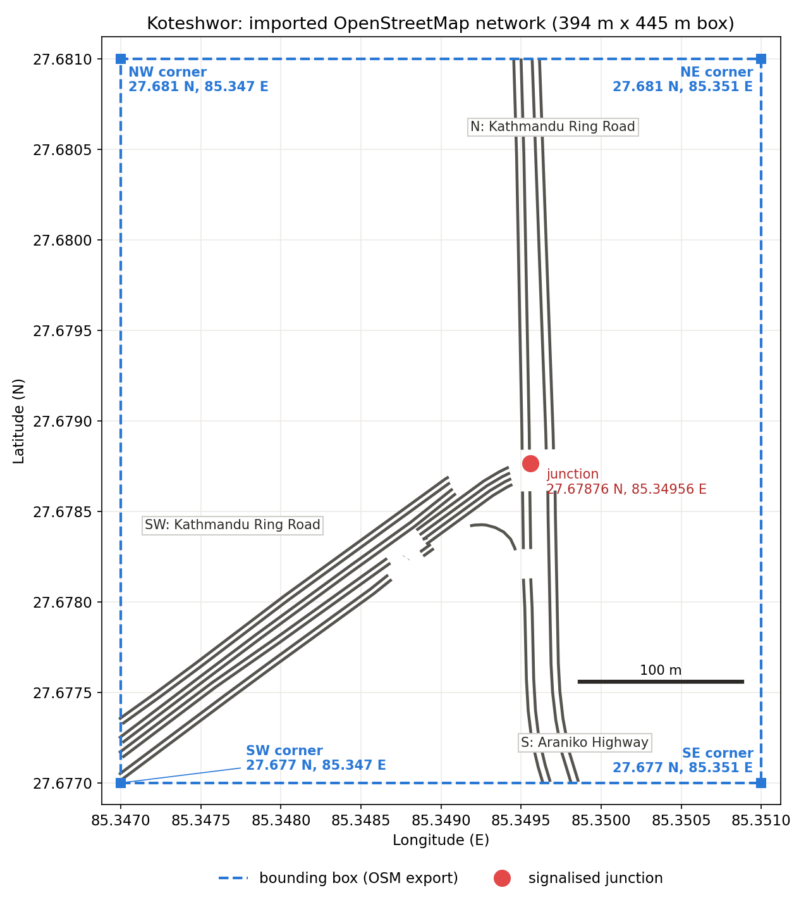
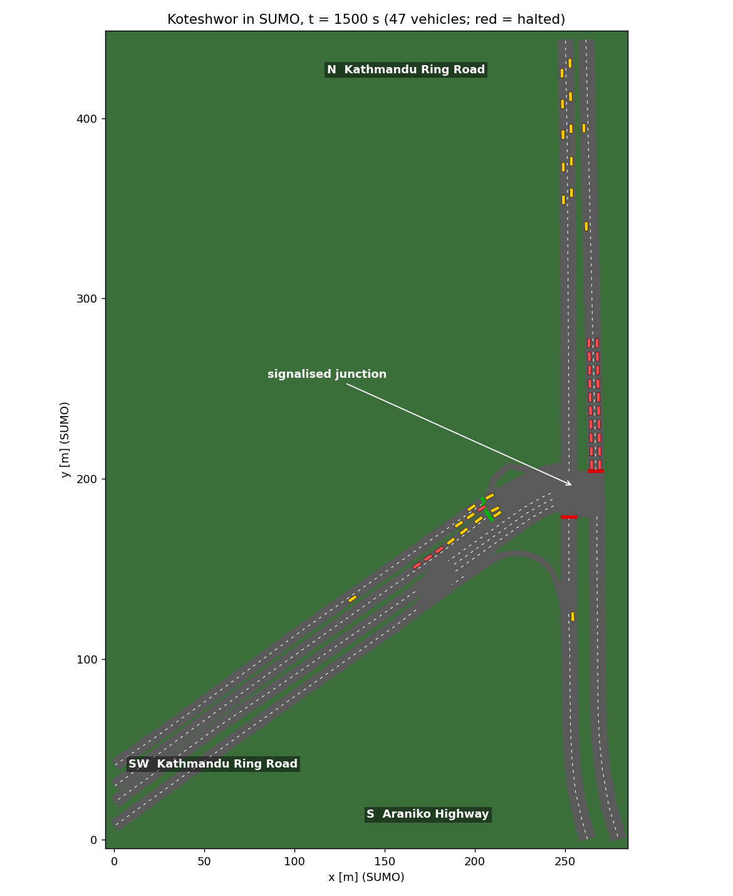
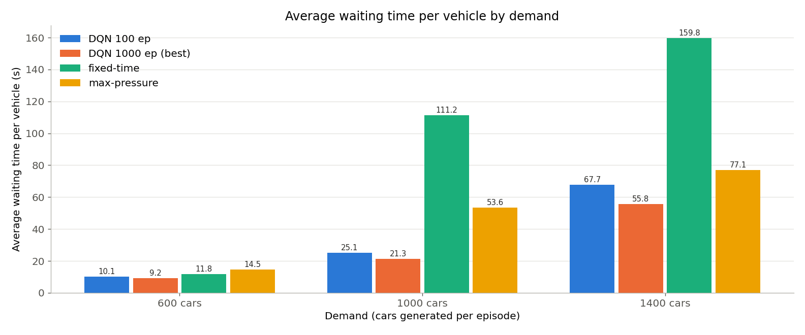
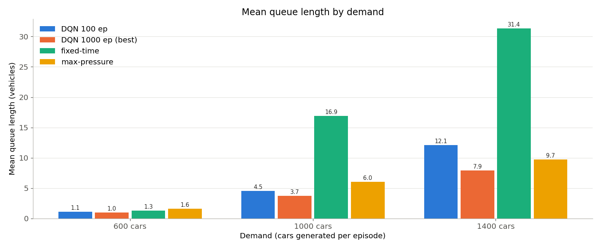
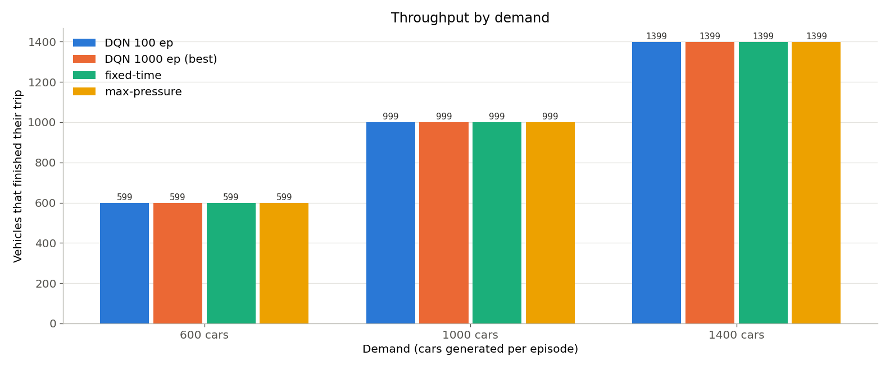
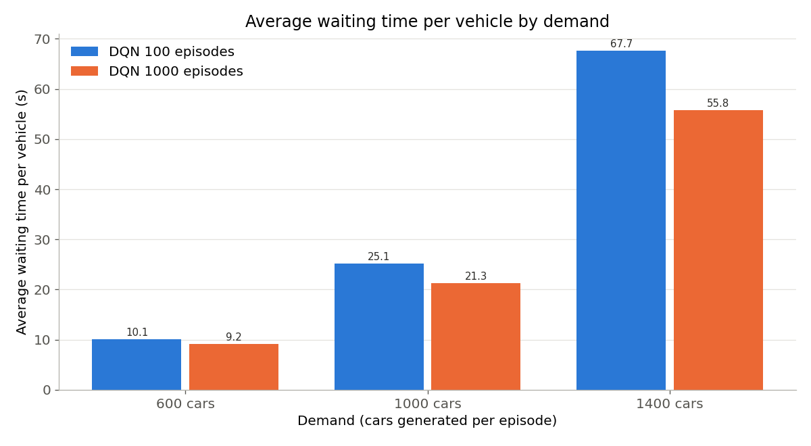
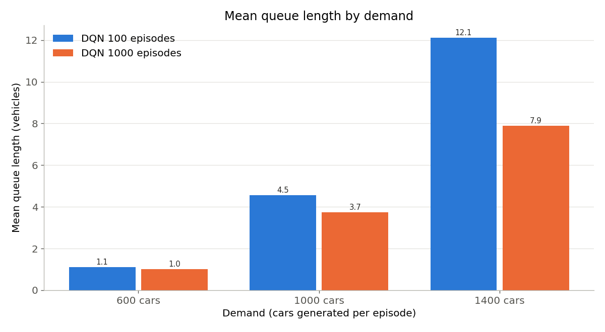
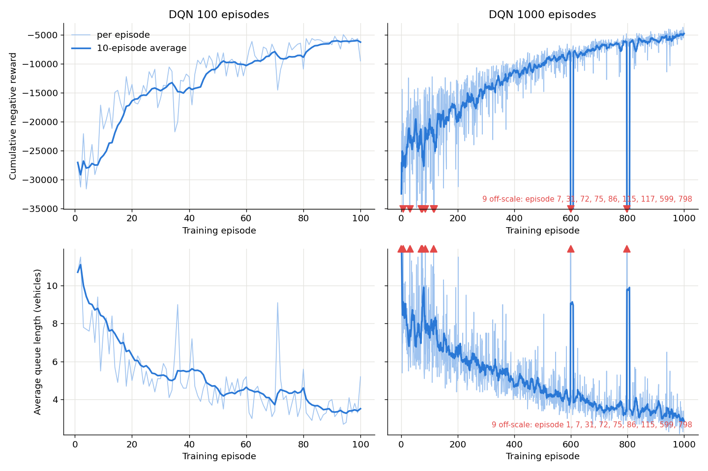
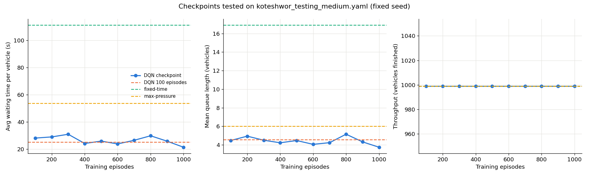

# Deep Q-Learning traffic signal control at Koteshwor, Kathmandu

Final figures and tables for presentation. The full analysis is in [../koteshwor_results.md](../koteshwor_results.md), and the limitations are in [limitations.md](limitations.md).

## Contents

| File | What it shows |
| --- | --- |
| `figures/network_bbox.png` | The imported OpenStreetMap network with the bounding box and its corner coordinates |
| `figures/koteshwor_sumo.png` | The same junction running in SUMO, with traffic and signal states |
| `figures/compare_wait.png`, `compare_queue_mean.png`, `compare_throughput.png` | The four controllers at three demand levels, one plot per metric |
| `figures/training_length_wait.png`, `training_length_queue.png` | DQN trained 100 vs 1000 episodes, test results |
| `figures/learning_curves.png` | Training curves of both DQN runs side by side |
| `figures/checkpoints_medium.png` | The 1000-episode run tested every 100 episodes |
| `tables/results_all_controllers.csv` | Every number in the results table, from `tlcs compare` |
| `tables/checkpoints_medium.csv` | Checkpoint test results |
| `tables/training_time.csv` | Training time of both runs |

## The junction



- **Location:** Koteshwor, Kathmandu, where the Ring Road meets the Araniko Highway. The signalised junction is at 27.67876 N, 85.34956 E.
- **Map area:** a 394 m × 445 m box from 27.677 N, 85.347 E (SW corner) to 27.681 N, 85.351 E (NE corner), exported from OpenStreetMap.
- **Roads:** three approaches: N Kathmandu Ring Road, S Araniko Highway, SW Kathmandu Ring Road. Traffic is left-hand. A free left-turn slip lane runs from Araniko to the SW Ring Road.
- **Agent:** sees 8 incoming lanes (40 state cells) and picks one of 3 green phases (one per approach) every 10 s, with a 4 s yellow on every change.



## Results

All controllers face the same traffic at each level: one 90-minute test episode, seed 10000. Low, medium and high demand are 600, 1000 and 1400 cars.

| Demand | Controller | Wait inside the map (s/car) | Wait to enter the map (s/car) | Total (s/car) | Mean queue (vehicles) | Throughput (cars) |
| --- | --- | ---: | ---: | ---: | ---: | ---: |
| Low | DQN 100 episodes | 10.1 | 0.0 | 10.1 | 1.11 | 599 |
| | **DQN 1000 episodes** | **9.2** | 0.0 | **9.2** | **1.01** | 599 |
| | Fixed-time | 11.8 | 0.0 | 11.9 | 1.31 | 599 |
| | Max-Pressure | 14.5 | 0.0 | 14.5 | 1.60 | 599 |
| Medium | DQN 100 episodes | 25.1 | 0.1 | 25.2 | 4.55 | 999 |
| | **DQN 1000 episodes** | **21.3** | 0.1 | **21.4** | **3.75** | 999 |
| | Fixed-time | 111.2 | 32.2 | 143.4 | 16.93 | 999 |
| | Max-Pressure | 53.6 | 3.0 | 56.5 | 6.03 | 999 |
| High | **DQN 100 episodes** | 67.7 | 53.6 | **121.2** | 12.12 | 1399 |
| | DQN 1000 episodes | **55.8** | 87.1 | 142.9 | **7.89** | 1399 |
| | Fixed-time | 159.8 | 413.4 | 573.1 | 31.35 | 1399 |
| | Max-Pressure | 77.1 | 212.1 | 289.2 | 9.70 | 1399 |

The "wait to enter" column is time cars spent waiting outside the map because the queue had reached its edge. It only matters at high demand, and it isn't plotted below.







**In short:**

- Both DQN agents beat fixed-time and Max-Pressure at all three demand levels, whether or not waiting outside the map is counted. The gap is largest at medium demand, the level the agents were trained on: 21 s per car against 57 s (Max-Pressure) and 143 s (fixed-time), all counted.
- Throughput is the same for every controller. All cars get through before the 90 minutes end, so it doesn't separate them.

## Training length: 100 vs 1000 episodes

Same agent, same settings. Only `total_episodes` differs.

| | DQN 100 episodes | DQN 1000 episodes |
| --- | ---: | ---: |
| Training time (CPU) | 16.6 min | 2 h 19 min |
| Time per episode | 9.9 s | 8.3 s |
| Exploration (epsilon) | 1.0 → 0 over 100 episodes | 1.0 → 0 over 1000 episodes |
| Training episodes that jammed completely | 0 | 2 (episodes 599 and 798) |
| Avg queue, last 50 training episodes | 3.97 | 3.04 |
| **Test, low demand:** total wait per car | 10.1 s | **9.2 s** |
| **Test, medium demand:** total wait per car | 25.2 s | **21.4 s** |
| **Test, high demand:** wait inside the map | 67.7 s | **55.8 s** |
| **Test, high demand:** total wait (incl. waiting to enter) | **121.2 s** | 142.9 s |







The plots show waiting inside the map only. Red markers flag episodes off the scale: early, mostly random episodes, and the two jammed episodes in the 1000-episode run.

- **At the training demand (medium) and at low demand, 1000 episodes are better:** 15% less waiting per car at medium, 9% at low.
- **At high demand, the longer-trained agent keeps queues inside the map shorter but lets more cars back up beyond the map edge.** Counting that, the 100-episode agent is better there.
- **The backlog builds on the Araniko Highway.** The agent sees only its last 35 m before the slip lane, so it can't tell how long that queue really is. At high demand, Araniko cars wait 324 s on average under the 1000-episode DQN, against 24 s for N Ring Road cars. This is a limit of the setup (what the agent can observe), not only of training length.
- **Longer training was less stable:** the 1000-episode run had two episodes where the junction jammed and never recovered. The 100-episode run had none.
- **Every checkpoint beats both baselines:** the model was saved every 100 episodes and each save tested at medium demand. Results move between 21 and 31 s per car, and the last one (episode 1000) is the best.



## Demo video

`scripts/demo_koteshwor.py` runs the best DQN (episode 1000) and then the fixed-time baseline at high demand. Each opens in its own full-screen SUMO-GUI window, zoomed on the junction, with identical traffic:

```bash
uv run python scripts/demo_koteshwor.py                  # 45 simulated minutes each (covers the rush), 20 ms per step
uv run python scripts/demo_koteshwor.py --minutes 90     # full episode; numbers then match the table above
uv run python scripts/demo_koteshwor.py --delay 50       # slower playback
```

- **Which controller is on screen:** the window title says it (`live_dqn.sumocfg`, then `live_fixed.sumocfg`).
- **Between runs:** the script waits for Enter, so you can restart the recording.
- **The moment to show:** the rush builds between about 10 and 30 simulated minutes.
  - Under fixed-time, the N Ring Road queue grows to the edge of the map: N cars average 935 s of total delay over the full episode.
  - Under the DQN, the N Ring Road keeps moving (24 s), but a queue builds on the Araniko Highway (324 s). Show both, since the second is the main weakness.
- **Results:** saved to `live/demo-koteshwor-high/`, with a comparison of both runs.
- **Recording:** use any screen recorder, for example the Windows Snipping Tool (Win+Shift+R), OBS, or the Xbox Game Bar (Win+Alt+R).

## Limitations

Read [limitations.md](limitations.md) before drawing conclusions about the real junction. In short: synthetic traffic, cars only, ideal lane discipline, a small map area, a plain DQN, a single training and test run, and a real junction that is police-controlled and due to change with a planned flyover.
