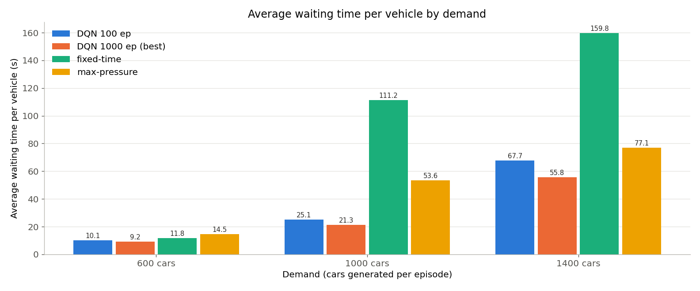
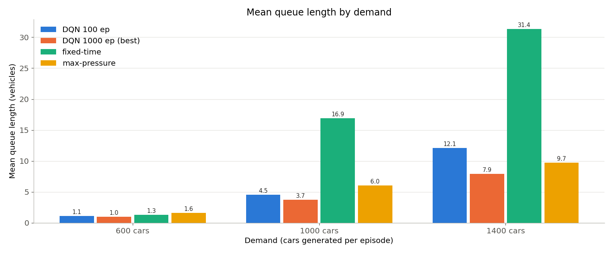
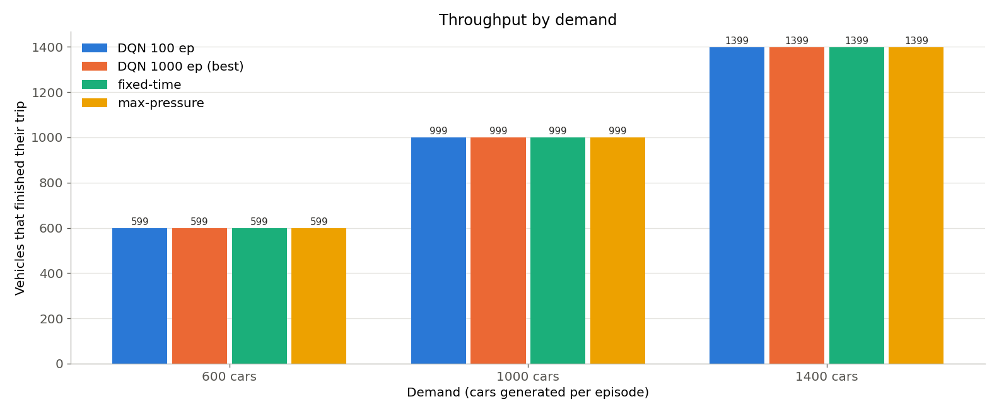
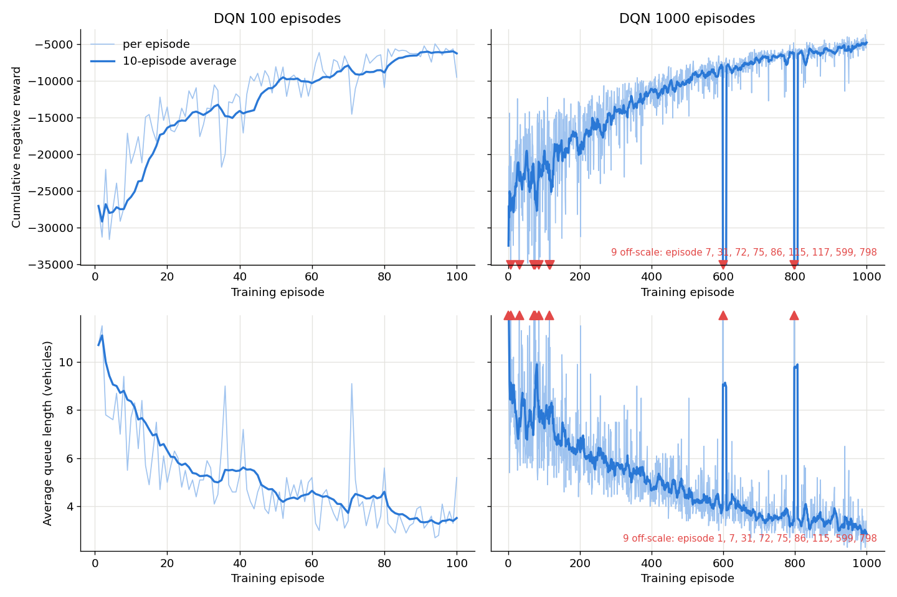
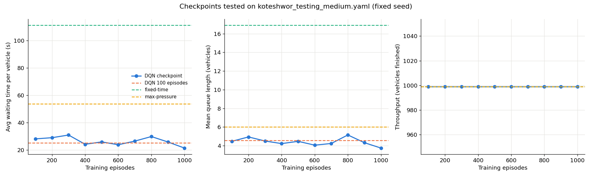

# Koteshwor: DQN trained for 100 vs 1000 episodes, against the baselines

This compares two DQN agents on the Koteshwor junction (Kathmandu, imported from OpenStreetMap) with two non-learning controllers, at three traffic levels. The agent design is the same in both runs. Only the number of training episodes differs.

## Setup

| | |
| --- | --- |
| Junction | Koteshwor, 3 approaches, left-hand traffic, one green phase per approach (3 actions) |
| DQN 100 ep | `model/koteshwor/`, trained with `settings/koteshwor_training.yaml` (100 episodes, ~17 min) |
| DQN 1000 ep | `model/koteshwor-dqn-1000/`, trained with `settings/koteshwor_training_1000.yaml`: the same file with `total_episodes: 1000` (2 h 19 min) |
| Training traffic | 1000 cars per 90-minute episode (the medium level), a different seeded pattern each episode |
| Baselines | Fixed-time (10 s green per approach) and Max-Pressure, deciding every 10 s with a 4 s yellow, like the DQN |
| Test traffic | One 90-minute episode per level with the **same fixed seed (10000)** for every controller |

| Demand level | Settings file | Cars per 90 min |
| --- | --- | --- |
| Low | `settings/koteshwor_testing_low.yaml` | 600 |
| Medium | `settings/koteshwor_testing_medium.yaml` | 1000 |
| High | `settings/koteshwor_testing_high.yaml` | 1400 |

## Summary

- **1000 episodes beat 100 episodes on waiting time inside the map at every demand level.** Average waiting time fell by 9% at low, 15% at medium and 18% at high demand. Mean queue fell by 9%, 18% and 35%.
- **At high demand that gain is not the whole story.** Queues then reach the edge of the map and cars wait to enter it. That entry delay is not part of the waiting time. Including it, the 100-episode agent is better at high demand (121 s against 143 s per car). See [Entry delay](#entry-delay-at-high-demand).
- **Both DQN agents beat fixed-time and Max-Pressure on average waiting time at all three levels.** The gap is largest at medium demand, the level they were trained on: 21 s per car for the 1000-episode agent against 54 s for Max-Pressure and 111 s for fixed-time.
- **Inside the map, the extra training mattered most at high demand.** There the 100-episode agent had a 25% *longer* mean queue than Max-Pressure, and the 1000-episode agent a 19% *shorter* one. Counting entry delay, though, the 100-episode agent does better at high demand (see above).
- **The best checkpoint is the final one (episode 1000).** Test results fluctuate between checkpoints, though (see below), so treat "final = best" as a single-test-episode result, not a guarantee.
- **Throughput does not separate the controllers.** Every controller gets every car through at every demand level.

## Results table

From `tlcs compare` (`comparison/koteshwor-dqn-100-vs-1000/summary.csv`). Lower waiting time and queue are better.

| Demand | Controller | Avg waiting time per car (s) | Mean queue (vehicles) | Throughput (cars finished) |
| --- | --- | ---: | ---: | ---: |
| Low (600) | DQN 100 ep | 10.1 | 1.11 | 599 |
| | **DQN 1000 ep** | **9.2** | **1.01** | 599 |
| | Fixed-time | 11.8 | 1.31 | 599 |
| | Max-Pressure | 14.5 | 1.60 | 599 |
| Medium (1000) | DQN 100 ep | 25.1 | 4.55 | 999 |
| | **DQN 1000 ep** | **21.3** | **3.75** | 999 |
| | Fixed-time | 111.2 | 16.93 | 999 |
| | Max-Pressure | 53.6 | 6.03 | 999 |
| High (1400) | DQN 100 ep | 67.7 | 12.12 | 1399 |
| | **DQN 1000 ep** | **55.8** | **7.89** | 1399 |
| | Fixed-time | 159.8 | 31.35 | 1399 |
| | Max-Pressure | 77.1 | 9.70 | 1399 |

Each level generates one car fewer than its nominal count (599, 999, 1399). The last generated car is scheduled to leave at the final second of the episode and never enters. This is the same for every controller.

### Entry delay at high demand

The waiting time above only counts time spent inside the map. When a queue reaches the edge of the map, new cars cannot enter and wait outside it. SUMO records that as `departDelay`, now the `avg_entry_delay_s` column of `tlcs compare`. It is near zero at low demand for everyone and at medium demand for both DQN agents. It is large at high demand:

| Demand | Controller | Wait inside the map (s) | Wait to enter (s) | **Total (s)** |
| --- | --- | ---: | ---: | ---: |
| Medium (1000) | DQN 100 ep | 25.1 | 0.1 | **25.2** |
| | DQN 1000 ep | 21.3 | 0.1 | **21.4** |
| | Fixed-time | 111.2 | 32.2 | **143.4** |
| | Max-Pressure | 53.6 | 3.0 | **56.5** |
| High (1400) | DQN 100 ep | 67.7 | 53.6 | **121.2** |
| | DQN 1000 ep | 55.8 | 87.1 | **142.9** |
| | Fixed-time | 159.8 | 413.4 | **573.1** |
| | Max-Pressure | 77.1 | 212.1 | **289.2** |

- With the total, both DQN agents still clearly beat both baselines at every level.
- At high demand the order of the two DQN agents flips: the 1000-episode agent keeps the queues inside the map shorter, but more cars back up beyond the map edge. The agent cannot see or be penalised for those: its state and reward cover only the lanes inside the map.
- The backlog is on the Araniko Highway, whose controlled lane is only 35 m long. Total delay per car at high demand under the 1000-episode DQN is 324 s for Araniko cars and 24 s for N Ring Road cars. Under fixed-time it is 421 s and 935 s.
- At medium demand, the level both agents trained on, nothing changes: the 1000-episode agent is better either way.

## Plots, one per metric







**Why throughput is flat:** cars stop being generated about 77 minutes into the 90-minute episode (most arrive in the first 45 minutes). Every controller clears the junction in the remaining time, even at high demand, so all cars finish. A difference in throughput would only appear with heavier or longer demand.

## Learning curves



Each panel shows the training episodes of one run: cumulative negative reward on top (higher is better), average queue below (lower is better). The light line is each episode and the dark line a 10-episode average. Both rows share their y-axis.

- The **100-episode run** drops its random exploration from 100% to 0% within 100 episodes. It ends with an average queue of about 3.5 on its training traffic.
- The **1000-episode run** explores ten times longer, so it looks worse early on. At episode 100 it is still choosing 90% of its actions at random. It then improves steadily and ends near a queue of 3.0 and a reward of about −5,000.
- **Two jammed episodes (599 and 798).** The junction locked up and the average queue stayed at 55–67 vehicles for the rest of the episode. SUMO is set never to remove stuck cars, so a jam lasts until the end. The next episode was normal both times and the trend kept improving, so training was not stopped. These two are marked as off-scale on the plot. The other off-scale points (episodes 1–117) are from the early, mostly random phase.

## Checkpoints

The model was saved every 100 episodes. Each checkpoint was tested on the medium level with the fixed seed (`docs/figures/checkpoints_medium.csv`).



| Checkpoint (episodes) | 100 | 200 | 300 | 400 | 500 | 600 | 700 | 800 | 900 | **1000** |
| --- | ---: | ---: | ---: | ---: | ---: | ---: | ---: | ---: | ---: | ---: |
| Avg wait (s) | 28.0 | 28.9 | 30.8 | 24.1 | 25.8 | 23.7 | 26.4 | 29.7 | 25.7 | **21.3** |
| Mean queue | 4.47 | 4.94 | 4.50 | 4.23 | 4.47 | 4.06 | 4.24 | 5.15 | 4.32 | **3.75** |

- **Best checkpoint: episode 1000, the final one.** It is the one used in the comparison above.
- Test performance does not rise smoothly. It moves between 21 and 31 s, with a dip at 800 right after the jammed episode 798. Every checkpoint, even the first, beats both baselines (54 and 111 s), but only checkpoints 400, 600 and 1000 beat the 100-episode agent (25.1 s).

## How much to trust this

- **One training run per agent and one test episode per demand level.** No repeat runs with other seeds were made, so there is no measure of spread. The checkpoint table shows that a single test can move by ±4 s between neighbouring checkpoints. Differences of a few seconds (for example at low demand) are within that noise. The large differences against the baselines at medium and high demand are not.
- **The agent was only trained at medium demand.** Low and high are tests of how it copes with traffic it never saw.
- **Worst-case queues are higher for the DQN at high demand.** The maximum queue was 55 cars for the 1000-episode agent against 35 for Max-Pressure, even though its average queue is lower. Together with the two jammed training episodes, this suggests the DQN can occasionally let one approach back up badly.
- **Other baselines exist.** SUMO's built-in actuated controller is not part of this comparison. In the earlier medium-demand run (`comparison/koteshwor/`) it averaged 18.0 s, better than both DQN agents.
- **Synthetic traffic and a synthetic signal plan.** Koteshwor is police-controlled in reality, and demand is generated, not counted. During tests SUMO warns that the SW green phase has two links into the same lane ("unsafe green phase"). This comes from the imported signal plan and applies equally to every controller.

## Reproduce

```bash
tlcs train --settings-file settings/koteshwor_training_1000.yaml --out-path model/koteshwor-dqn-1000

uv run python scripts/eval_checkpoints.py --run model/koteshwor-dqn-1000 \
  --settings-file settings/koteshwor_testing_medium.yaml --test-name test-medium \
  --reference "DQN 100 episodes=model/koteshwor/test" \
  --reference "fixed-time=baselines/koteshwor/fixed" --reference "max-pressure=baselines/koteshwor/maxpressure"

# per level (low / high; medium results for DQN 100, fixed and max-pressure are in model/koteshwor/test and baselines/koteshwor/)
tlcs test     --settings-file settings/koteshwor_testing_low.yaml --model-path model/koteshwor --test-name test-low
tlcs test     --settings-file settings/koteshwor_testing_low.yaml --model-path model/koteshwor-dqn-1000/checkpoints/episode_1000 --test-name test-low
tlcs baseline --settings-file settings/koteshwor_testing_low.yaml --controller fixed       --test-name fixed       --out-path baselines/koteshwor-low
tlcs baseline --settings-file settings/koteshwor_testing_low.yaml --controller maxpressure --test-name maxpressure --out-path baselines/koteshwor-low

uv run python scripts/plot_learning_curves.py --runs model/koteshwor model/koteshwor-dqn-1000 \
  --labels "DQN 100 episodes" "DQN 1000 episodes" --out docs/figures/learning_curves.png --clip
```

The `tlcs compare` call that makes the table and the three plots takes the 12 test folders and labels them `DQN 100 ep`, `DQN 1000 ep (best)`, `fixed-time` and `max-pressure` at each level (output in `comparison/koteshwor-dqn-100-vs-1000/`).
