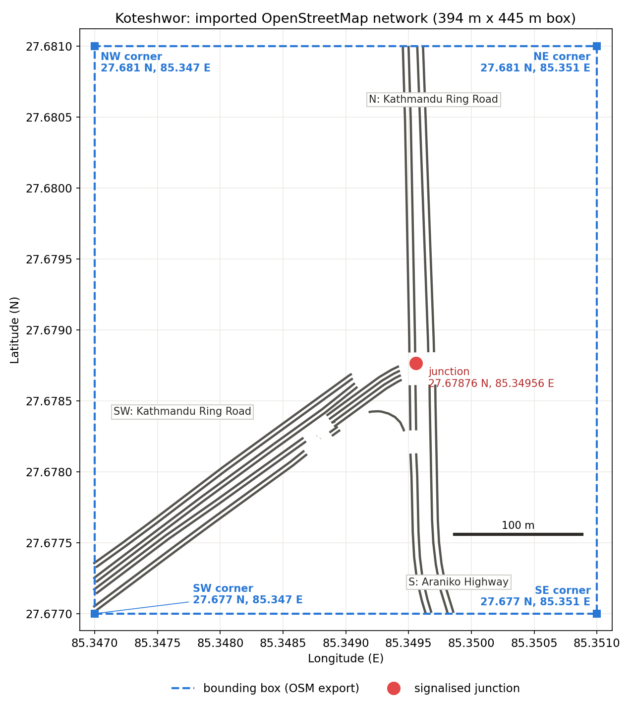
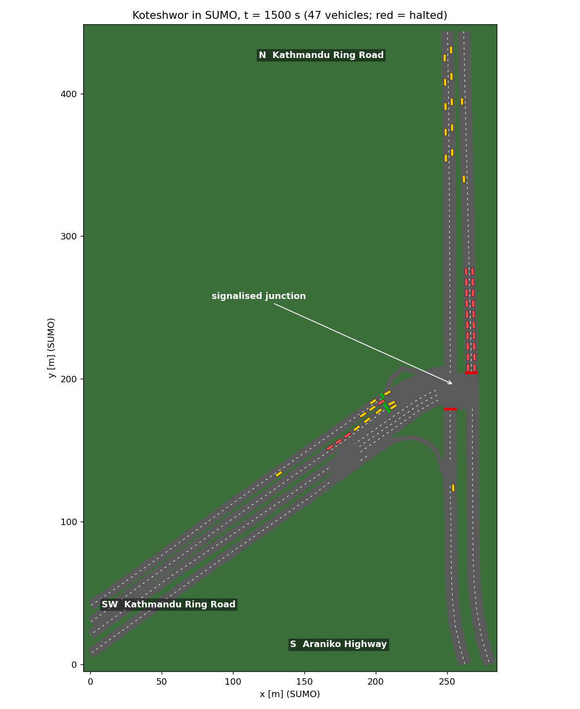
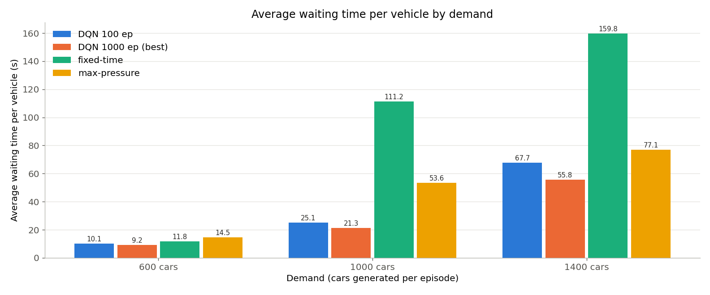

# Deep Q-Learning Traffic Signal Control at Koteshwor, Kathmandu

A Deep Q-Learning (DQN) agent that learns to run the traffic light of a real junction, Koteshwor in Kathmandu, simulated in [SUMO](https://eclipse.dev/sumo/). It is compared with classic signal controllers at three traffic levels.

<p align="center">
  
  
</p>
<p align="center"><em>Left: the junction imported from OpenStreetMap, with its bounding box. Right: the same junction running in SUMO.</em></p>

## Contents

1. [Introduction](#introduction)
2. [Results at a glance](#results-at-a-glance)
3. [Methodology](#methodology)
4. [Installation](#installation)
5. [Usage](#usage)
6. [Configuration](#configuration)
7. [Project structure](#project-structure)
8. [Limitations](#limitations)
9. [Conclusion](#conclusion)

## Introduction

Koteshwor is a busy junction on the Kathmandu Ring Road, where the Ring Road meets the Araniko Highway. This project asks whether a reinforcement-learning agent can control a traffic light there better than fixed rules.

- **The junction:** the real road layout is imported from OpenStreetMap into the SUMO traffic simulator.
- **The agent:** a DQN observes where cars are queued and picks which approach gets green every 10 seconds.
- **The comparison:** the trained agent is tested against fixed-time and Max-Pressure control on identical traffic, at low, medium and high demand.
- **Training length:** two agents are compared, trained for 100 and for 1000 episodes.

The code is generic: any SUMO network with one signalised junction works. A synthetic 4-way junction and a T-junction are included as well.

## Results at a glance

One 90-minute test episode per demand level, with identical traffic (seed 10000) for every controller. Values are the average delay per car in seconds: waiting inside the map plus waiting to enter it when queues reach the map edge.

| Controller | Low (600 cars) | Medium (1000 cars) | High (1400 cars) |
| --- | ---: | ---: | ---: |
| DQN, 100 training episodes | 10.1 | 25.2 | **121.2** |
| DQN, 1000 training episodes | **9.2** | **21.4** | 142.9 |
| Max-Pressure | 14.5 | 56.5 | 289.2 |
| Fixed-time | 11.9 | 143.4 | 573.1 |

<p align="center">
  
</p>

- **Both DQN agents beat both baselines at every demand level.**
- **1000 training episodes are better at low and medium demand.** Medium is the level the agents were trained on.
- **At high demand, the 1000-episode agent under-serves the Araniko Highway.** It can only see the last 35 m of that road, so a long queue builds there.

Full analysis: [docs/koteshwor_results.md](docs/koteshwor_results.md). Presentation figures and tables: [docs/final/](docs/final/README.md).

## Methodology

### 1. Study area and network

The junction is imported from OpenStreetMap with `scripts/import_osm.py`, which builds the network and checks it.

| | |
| --- | --- |
| Location | Koteshwor junction, 27.67876 N, 85.34956 E |
| Map area | Bounding box 27.677–27.681 N, 85.347–85.351 E (about 394 m × 445 m), stored in `intersection/koteshwor/bbox.yaml` |
| Approaches | N Kathmandu Ring Road, S Araniko Highway, SW Kathmandu Ring Road |
| Traffic rule | Left-hand traffic. A free left-turn slip lane from Araniko to the SW Ring Road bypasses the signal. |

The import:

1. Downloads exactly the bounding box from OpenStreetMap and clips the roads at its edges.
2. Converts it with SUMO's `netconvert`, keeping only the arterial roads (cars only).
3. Joins the 7 OSM nodes of the junction into one, then re-applies the OSM turn restrictions.
4. Places a single traffic light on the junction.
5. Checks the result: junction position (24 m from the expected point), arm lengths (N 239 m, S 162 m, SW 251–256 m), lanes, allowed turns and signal phases.

### 2. Traffic demand

Traffic is generated fresh for each episode by `src/tlcs/generator.py`:

- **Departure times:** a Weibull distribution over the 90-minute episode, giving a rush that peaks between about 15 and 30 minutes.
- **Routes:** each car goes straight with probability 75%, otherwise it takes one of the turns. The movement within each group is picked uniformly. U-turns and the slip lane get no traffic.
- **Vehicles:** one passenger-car type.
- **Demand levels:** 600 (low), 1000 (medium, used for training) and 1400 (high) cars per episode.
- **Seeds:** training uses the episode number as the seed. Testing always uses seed 10000, so every controller sees the same cars.

### 3. State, actions and reward

- **State:** each of the 8 incoming lanes is split into 5 cells, from the stop line back. Cells are short near the stop line (7.5 m) and longer further back. A cell is 1 if it holds a car. That gives 40 binary inputs. The Araniko lanes are only 35 m long before the slip lane, so they get five 7 m cells.
- **Actions:** one green phase per approach (N, S or SW), 3 actions in total. The agent decides every 10 s. A 4 s yellow is inserted whenever the phase changes.
- **Reward:** the drop in total waiting time on the incoming lanes since the last decision:

  ```text
  reward = previous_total_wait - current_total_wait
  ```

Nothing about the junction is hard-coded. `src/tlcs/network.py` reads the traffic light, lanes, movements and phases from the SUMO network at startup.

### 4. Agent and training

- **Network:** fully connected, 40 inputs → 4 hidden layers of 400 units → 3 Q-values. Trained with MSE loss and Adam (learning rate 0.001).
- **Q-learning target:** `r + γ · max Q(s', a')` with `γ = 0.75`.
- **Exploration:** epsilon-greedy, with epsilon decaying linearly from 1 to 0 over all training episodes.
- **Experience replay:** up to 50,000 transitions. After each episode the network trains on 800 random batches of 100.
- **Checkpoints:** the model is saved every 100 episodes (`checkpoint_every`). Each checkpoint can be tested on its own.
- **Training runs:** 100 episodes (17 min on CPU) and 1000 episodes (2 h 19 min). Nothing else differs between them.

### 5. Baselines and evaluation

All controllers run on the same test traffic and through the same code path. Each decides every 10 s, with a 4 s yellow on every change.

| Controller | Rule |
| --- | --- |
| `fixed` | Cycles through the phases with a fixed green time |
| `maxpressure` | Green to the phase with the highest pressure: cars on its incoming lanes minus cars on its outgoing lanes |
| `lqf` | Green to the phase with the longest queue |
| `random` | A random phase each time (sanity check) |
| `actuated` | SUMO's built-in actuated signal |

The comparison uses fixed-time and Max-Pressure. The other three are available too.

**Metrics** (from SUMO's per-vehicle trip records):

- **Waiting time per car:** time spent stopped inside the map.
- **Entry delay per car:** time spent waiting outside the map because the queue reached its edge. This is reported separately and added for the total delay.
- **Mean queue length:** halted vehicles on the incoming lanes, averaged over the episode.
- **Throughput:** cars that finished their trip.

## Installation

Requirements:

- [uv](https://astral.sh/uv), which installs Python 3.13 for you if needed.
- [SUMO](https://sumo.dlr.de/docs/Installing/), with `SUMO_HOME` set and `sumo` / `sumo-gui` on your PATH.
- A GPU is not needed: training runs on the CPU.

From the project root:

```bash
uv sync            # install dependencies
uv run tlcs --help # check the CLI works
sumo --version     # check SUMO is found
```

Run every command from the project root. Prefix `tlcs` with `uv run`, or activate the environment first: `source .venv/bin/activate`, or `.venv\Scripts\activate` on Windows.

## Usage

### Train and test

```bash
# Train (100 episodes) and test on the default Koteshwor scenario
tlcs train --settings-file settings/koteshwor_training.yaml --out-path model/koteshwor
tlcs test  --settings-file settings/koteshwor_testing.yaml  --model-path model/koteshwor

# 1000-episode run, tested at the three demand levels
tlcs train --settings-file settings/koteshwor_training_1000.yaml --out-path model/koteshwor-dqn-1000
tlcs test  --settings-file settings/koteshwor_testing_high.yaml \
           --model-path model/koteshwor-dqn-1000/checkpoints/episode_1000 --test-name test-high
```

- **GUI:** testing opens SUMO-GUI (`gui: true`). Press ▶ to start and use the *Delay* slider to slow it down. The demand presets run headless.
- **Overwriting:** if an output folder exists, the CLI asks before overwriting it.

### Baselines

```bash
tlcs baseline --controller fixed       --test-name fixed       --settings-file settings/koteshwor_testing_high.yaml --out-path baselines/koteshwor-high
tlcs baseline --controller maxpressure --test-name maxpressure --settings-file settings/koteshwor_testing_high.yaml --out-path baselines/koteshwor-high
```

Use the same testing settings file as for `tlcs test`, so the traffic is identical.

### Compare

```bash
tlcs compare --runs model/koteshwor/test baselines/koteshwor/fixed baselines/koteshwor/maxpressure \
             --out-path comparison/koteshwor-medium
```

- **Outputs:** a `summary.csv` table plus one plot per metric: waiting time, mean queue and throughput.
- **One demand level:** you also get queue and reward plots over time.
- **Several demand levels:** the bar charts are grouped by demand. Use `--labels` so each controller has the same name at every level, for example `--labels "DQN,fixed,DQN,fixed"`.

### Watch and record

```bash
tlcs live --settings-file settings/koteshwor_testing.yaml --model-path model/koteshwor   # all controllers side by side
uv run python scripts/demo_koteshwor.py                                                  # best DQN, then fixed-time, high demand
```

- **`tlcs live`:** opens one SUMO-GUI window per controller, all on the same traffic and stepping together.
- **The demo script:** made for screen recordings. It shows one full-screen window per controller and waits for Enter between them.
  - `--minutes`: simulated minutes per run (default 45).
  - `--delay`: ms per step (default 20).
  - `--headless`: no GUI, to check that it runs.

### Analysis scripts

```bash
# Test every checkpoint at medium demand and plot results against training episodes
uv run python scripts/eval_checkpoints.py --run model/koteshwor-dqn-1000 \
  --settings-file settings/koteshwor_testing_medium.yaml --test-name test-medium

# Learning curves of two runs side by side
uv run python scripts/plot_learning_curves.py --runs model/koteshwor model/koteshwor-dqn-1000 \
  --labels "100 episodes" "1000 episodes" --out docs/figures/learning_curves.png --clip

# Network picture with the bounding box coordinates
uv run python scripts/plot_network_bbox.py --network koteshwor --out docs/final/figures/network_bbox.png

# Re-import the junction from OpenStreetMap (or re-check it after manual edits)
uv run python scripts/import_osm.py
uv run python scripts/import_osm.py --verify-only
```

### Tests

```bash
uv run pytest
```

The tests cover network discovery, the OSM import, traffic generation, settings, baselines, checkpoints and the comparison tool. They don't need SUMO.

## Configuration

Settings are YAML files in `settings/`, validated when loaded.

| File | Purpose |
| --- | --- |
| `koteshwor_training.yaml` | Training, 100 episodes, medium demand |
| `koteshwor_training_1000.yaml` | Same, 1000 episodes |
| `koteshwor_testing.yaml` | Testing with the GUI, medium demand |
| `koteshwor_testing_low.yaml`, `_medium.yaml`, `_high.yaml` | Demand presets: 600, 1000 and 1400 cars, headless, seed 10000 |
| `training_settings.yaml`, `testing_settings.yaml` | Synthetic 4-way junction |
| `t_junction_*.yaml` | Synthetic T-junction |

Main keys:

| Key | Meaning |
| --- | --- |
| `network`, `signal_program` | Network folder under `intersection/`, and the file with the signal phases (each green is one action) |
| `total_episodes`, `max_steps`, `n_cars_generated` | Episodes, steps per episode (1 step = 1 s), cars per episode |
| `green_duration`, `yellow_duration`, `turn_chance` | Time between decisions, yellow length, share of turning cars |
| `num_layers`, `width_layers`, `learning_rate`, `batch_size`, `training_epochs` | Network size and training per episode |
| `memory_size_min`, `memory_size_max`, `gamma` | Replay buffer warm-up and size, discount factor |
| `cells_per_lane`, `checkpoint_every` | State cells per lane, checkpoint interval (0 = off) |
| `episode_seed` | Test traffic seed (testing only) |
| `fixed_green_durations`, `actuated_max_green` | Optional baseline settings (testing only) |

## Project structure

```text
src/tlcs/            Python package
  cli.py               tlcs train | test | baseline | compare | live
  network.py           reads the junction from the SUMO network
  env.py               SUMO environment: state, reward, actions
  generator.py         per-episode traffic
  agent.py, model.py, memory.py   DQN agent, neural network, replay buffer
  main.py              training and testing loops, checkpoints
  baselines.py         fixed-time, max-pressure, LQF, random, actuated
  compare.py           comparison table and plots
  live.py              side-by-side viewer
  osm_import.py        OpenStreetMap import helpers
scripts/             import_osm, demo_koteshwor, eval_checkpoints, plot_learning_curves, plot_network_bbox
intersection/        one folder per network: koteshwor/, original/, t_junction/
settings/            YAML settings
docs/                koteshwor_results.md, final/ (figures, tables, limitations)
tests/               pytest suite
```

Generated outputs go to `model/` (trained models and checkpoints), `baselines/`, `comparison/` and `live/`. They are committed, so the results in the docs can be inspected without re-running anything.

Tips:

- **One command per network at a time:** runs on the same network share its traffic file, so don't run two at once. Different networks are fine.
- **Windows `UnicodeEncodeError`:** if output redirected to a file fails with this error, run `$env:PYTHONIOENCODING="utf-8"` first.

## Limitations

These results describe the simulation, not the real junction. In short:

- **Synthetic traffic:** generated, not counted, and tested with a single seed per demand level.
- **Cars only:** no motorcycles, buses, trucks or pedestrians.
- **Ideal lane discipline:** simulated drivers keep to their lanes and obey the signal perfectly. Real Kathmandu traffic is far less orderly.
- **Short approach roads:** the agent sees only the lanes inside a 400 m map. It sees just 35 m of the Araniko Highway, which explains its weak spot at high demand.
- **Plain DQN:** no target network, Double DQN or prioritised replay. Training had two episodes where the junction jammed completely.
- **The real junction:** it is police-controlled, so the traffic light and its phases are a modelling assumption. A planned flyover would change the layout.

Details: [docs/final/limitations.md](docs/final/limitations.md).

## Conclusion

On the simulated Koteshwor junction, a DQN signal controller clearly beats fixed-time and Max-Pressure control at all three demand levels. At the demand it was trained on, the 1000-episode agent cuts the average delay per car to 21 s, against 57 s for Max-Pressure and 143 s for fixed-time. Training ten times longer helped at low and medium demand.

At high demand, the agent's limited view of the short Araniko approach let a long queue build there. Counting that queue, the 100-episode agent did better. SUMO's built-in actuated controller, not part of this comparison, was also slightly better at medium demand (18 s in an earlier run).

Next steps to make the results transferable:

- Extend the map so every approach is long enough to observe.
- Use real traffic counts and mixed vehicles, including motorcycles.
- Add standard DQN stabilisation such as a target network.
- Repeat training and tests with several seeds.

## Acknowledgements and license

Based on [Deep-QLearning-Agent-for-Traffic-Signal-Control](https://github.com/AndreaVidali/Deep-QLearning-Agent-for-Traffic-Signal-Control) by Andrea Vidali. Map data © OpenStreetMap contributors. MIT license, see `LICENSE`.
